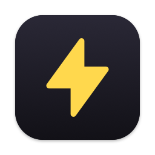
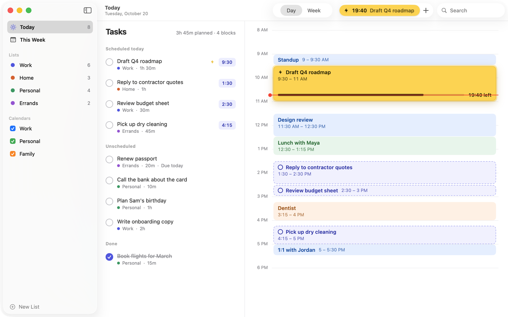
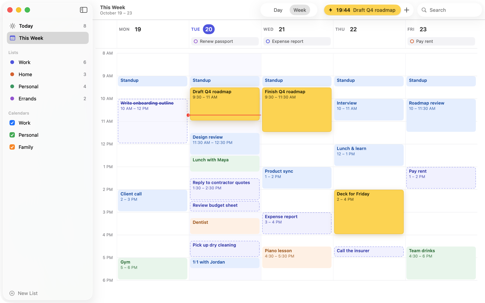

<p align="center">
  
</p>

<h1 align="center">SparkPlug</h1>

<p align="center"><b>Put your to-dos on the calendar.</b><br>
A small, open-source Mac app that shows your tasks and your meetings side by side.</p>



SparkPlug keeps your task list next to the calendars already on your Mac. Give each task a rough
length, drag it into a free slot on today's timeline, and start a focus block when it's time. You
can see what your day can actually hold before you commit to it.

It talks only to the calendars on your Mac, through Apple's EventKit. **There is no account, no server, no
sync service and no analytics, and SparkPlug makes no network requests of its own.**

## Features

- **Your calendars, read in place.** Any calendar you've added to the Mac (iCloud, Google, Exchange,
  On My Mac) appears on the timeline, with no setup. Hide one with a click in the sidebar.
- **Tasks with a rough length.** Type a task and add a length at the end, for example `Renew passport 20m`,
  `Write onboarding copy 2h` or `Review 1h30m`. Lists keep work, home and errands apart.
- **Drag to schedule.** Drag a task onto the timeline to give it a block. A dashed slot shows where it will
  land, snapped to 15 minutes. Drag a block to move it, or back onto the list to unschedule it. Pull its
  bottom edge to make it longer.
- **Unfinished tasks come back.** When a block ends and its task is still open, the task goes back to
  your list so you can give it a new time.
- **Focus.** Start Focus and SparkPlug counts the block down, keeps the task in the toolbar, and
  (with two Shortcuts you choose) turns on Do Not Disturb until the block ends. Mark a task as a *focus
  block* and Focus starts by itself when the block begins.
- **This week.** A column per day, with what's due, all-day events and every block. Drag blocks
  between days. Weekends are optional.
- **Blocks stay yours.** By default your blocks live only in SparkPlug. If you want colleagues to see
  you as busy, choose a calendar in Settings and SparkPlug keeps a copy of each block there. Copies
  move with the block and are removed when the task goes back to your list. A copy is an ordinary
  event with the task's title, so it syncs and is shared like anything else on that calendar.



## Requirements

- macOS 14 Sonoma or later
- To build it: Xcode 26 or later and [XcodeGen](https://github.com/yonaskolb/XcodeGen)

## Build and run

```sh
brew install xcodegen
git clone https://github.com/mentat/sprkplg.git
cd sprkplg
make run
```

`make run` generates the Xcode project from `project.yml`, builds a Debug app into `build/`, and
opens it. Other targets:

| Command | What it does |
|---|---|
| `make demo` | Opens SparkPlug on a sample week. Your calendars and tasks are not read or changed, and nothing is saved. |
| `make test` | Runs the core package's tests, then builds the app and runs its tests. |
| `make open` | Generates `SparkPlug.xcodeproj` and opens it in Xcode. |
| `make run CONFIG=Release` | A Release build. |
| `make run TEAM=ABCDE12345` | Signs with your Apple developer team instead of ad-hoc signing. |

Builds are ad-hoc signed by default, so you don't need an Apple developer account. macOS remembers
calendar access per signature, so an ad-hoc build may ask again after a rebuild. Signing with your own
team (`TEAM=…`) avoids that.

## First launch

SparkPlug starts with four empty lists (Work, Home, Personal, Errands) and asks to see your calendars.
Allowing access is optional. Without it, tasks, blocks and Focus still work and the timeline is simply
empty of meetings. You can change your mind any time in **System Settings › Privacy & Security ›
Calendars**.

| Shortcut | |
|---|---|
| ⌘N | New task (Return adds it and keeps the row open for the next one; Esc closes it) |
| ⌘1 / ⌘2 | Day / Week |
| ⇧⌘F | Start or stop Focus |
| ⌘, | Settings |

Double-click a task or a block to edit it, or right-click for quick actions: length, list, due date,
focus block, start now, move back to the list, delete.

## Turning on Do Not Disturb during Focus

macOS doesn't let apps switch Focus modes themselves, so SparkPlug runs two Shortcuts that you make once:

1. Open **Shortcuts** and create a shortcut named, for example, *SparkPlug Focus On*, with the action
   **Set Focus** set to *Turn Do Not Disturb On* (or any Focus you like).
2. Create *SparkPlug Focus Off* with **Set Focus** set to *Turn Do Not Disturb Off*.
3. In SparkPlug, open **Settings › Focus** and choose them. **Run** tries each one.

SparkPlug runs them with `/usr/bin/shortcuts` when Focus starts and when it ends. This is also why
the app is not sandboxed: a sandboxed app cannot run the `shortcuts` tool.

## Your data

Tasks, lists and settings are saved as one JSON file at
`~/Library/Application Support/io.sprkplg.SparkPlug/library.json`. **Settings › General › Show in
Finder** opens the folder.

- Saves are atomic, so a crash mid-save leaves the previous version intact.
- If the file can't be read, it is moved aside with an `unreadable-…` suffix and SparkPlug starts
  fresh. It is never overwritten.
- If the file was written by a newer SparkPlug, it is left alone and nothing is saved until you update.
- Run one copy of SparkPlug at a time. Two copies (say, a build from source and one in
  /Applications) save to the same file, and the last one to save wins.

SparkPlug writes to a calendar only if you choose one under **Settings › Calendars › Copy blocks to**.
Even then it writes only its own copies of your blocks, each marked with a `sparkplug://task/…` link
in its URL and notes. It never changes or deletes any other event.

## How it's built

```
Core/            SparkPlugCore, a Swift package with no dependencies: the data model, the JSON store,
                 time formatting, timeline layout (overlap columns, snapping) and the planning rules
                 (task groups, finished blocks, focus targets). `swift test --package-path Core`.
App/             The SwiftUI app: AppModel (state and every change to it), the EventKit adapter,
                 the Shortcuts runner, the demo data and the views.
AppTests/        The app model's tests, against an in-memory calendar.
project.yml      The XcodeGen project (the .xcodeproj is generated, not committed).
scripts/         make-icon.swift draws the app icon.
```

SwiftUI and Swift 6 strict concurrency, built with warnings as errors.

## Contributing

Issues and pull requests are welcome. See [CONTRIBUTING.md](CONTRIBUTING.md).

## License

[MIT](LICENSE) © 2026 Jesse Lovelace
